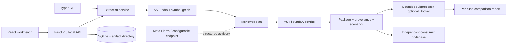

# Architecture

Slim is a local-first extraction workbench. The product promise is **move a
feature, adapt its boundary, and show behavioral evidence**. It is deliberately
more than copying a function and deliberately less than proving program equivalence.

## System

## Boundaries and ownership

* `analysis`: parse source files, index module-level symbols, resolve imports and
  compute a transitive dependency closure. No source code is executed.
* `models`: versioned, validated wire contracts shared by CLI, API and exports.
* `extraction`: deterministic transforms, packaging, provenance and integrity.
* `validation`: fresh process per original/candidate case, tagged JSON values,
  timeout and resource bounds, exception comparison, explicit unverified results.
* `providers`: optional Llama guidance with validated structured output. Model
  suggestions never execute commands and never change a reviewed plan silently.
* `repository`: bounded local paths and pinned, read-only HTTPS GitHub clones.
* `service`: orchestrates stages, commits durable events and produces artifacts.
* `api`: local HTTP boundary, input validation, downloads and background jobs.
* `web`: accessible workbench, real backend data, no fabricated success states.

## Important decisions

**AST rather than regex.** Python's parser gives source ranges, scope and import
structure. Resolution is conservative: unsupported dynamic behavior becomes a
warning or blocker. The original source remains available next to generated code.

**Preserve modules rather than flatten everything.** Relative modules keep their
namespaces and are relocated into a generated package. This avoids symbol
collisions and makes provenance inspectable. Only needed declarations are retained.

**Explicit dependency injection.** A reviewed boundary such as
`db.load_shipping_rules()` can become a keyword-only `shipping_rules` parameter
on the selected entry function. Calls deeper in the closure are rejected rather
than partially rewritten. Comparison fixtures provide original DB state and the
same rules to the candidate; Slim records this adaptation.

**SQLite rather than a distributed queue.** One local process and a bounded
executor suffice for a filmable prototype. Durable stages and events survive a
browser refresh; interrupted jobs are marked interrupted on startup. A production
multi-tenant system would need authenticated workers, queue leases and stronger
container isolation.

**Model advice rather than model authority.** The offline analyzer is complete
without a model. A Meta Llama endpoint may rank symbols and explain boundaries.
The UI records the exact provider and model. Failed model calls are visible and
do not become a claim of AI-assisted execution.

**Evidence rather than equivalence claims.** Reports distinguish matching,
divergent and unverified cases. A matching exception is a valid tested behavior;
an import failure or timeout is not. No percentage implies coverage of all inputs.

## Execution model

The default server disables arbitrary execution. The checked-in commerce demo
is trusted and runnable. Other repositories require the operator to enable local
execution or select Docker. A local subprocess is process isolation, **not a
security sandbox**. Docker uses no network, a read-only filesystem, dropped
capabilities, a non-root user, memory/CPU/PID limits and a temporary writable area.
Docker itself is still not a complete hostile-code security boundary.

## Delivery

Source → analysis → user confirms symbol → plan → user reviews boundaries →
package → user requests validation → comparison → wheel → install in consumer.

Artifacts include generated source, source hashes and commit, dependency list,
upstream license copies, README, scenarios and validation report. Local output
paths and API IDs are confined to the configured workspace. Source checkouts are
never modified by extraction.
