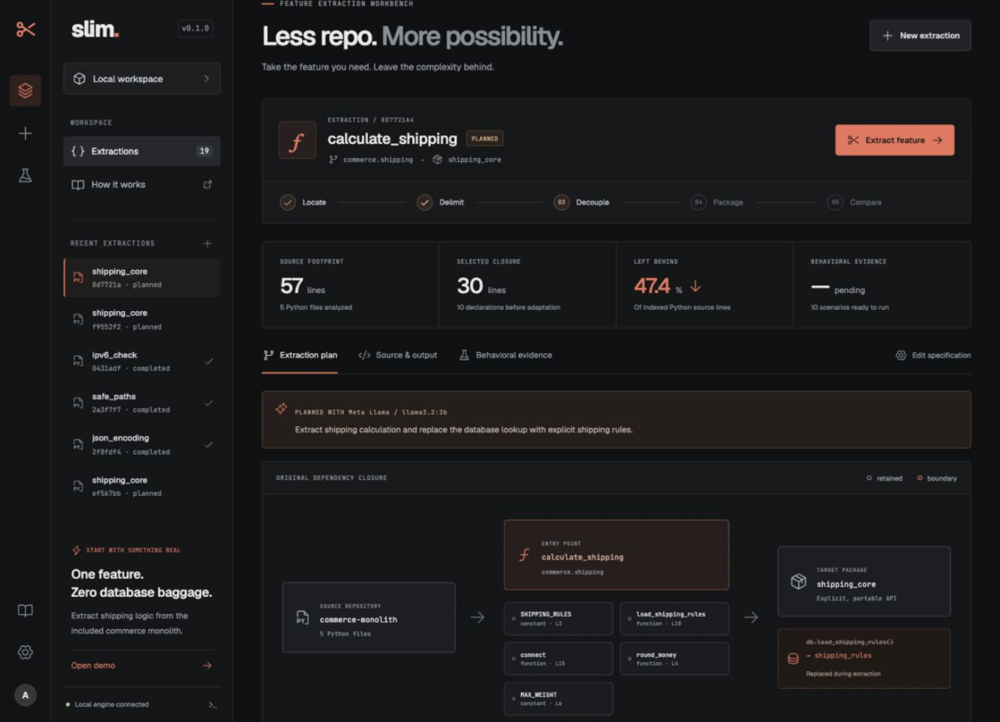
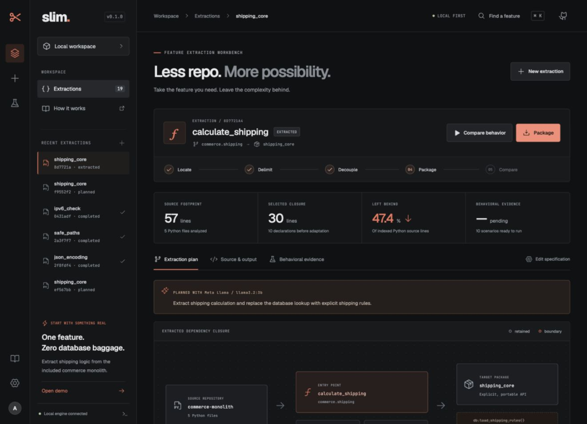
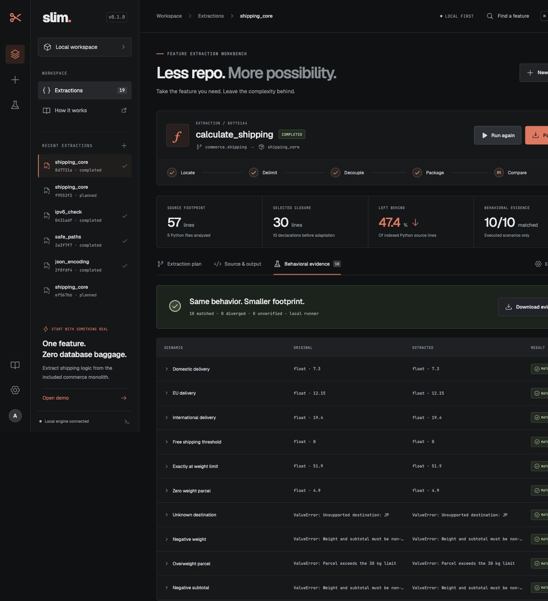
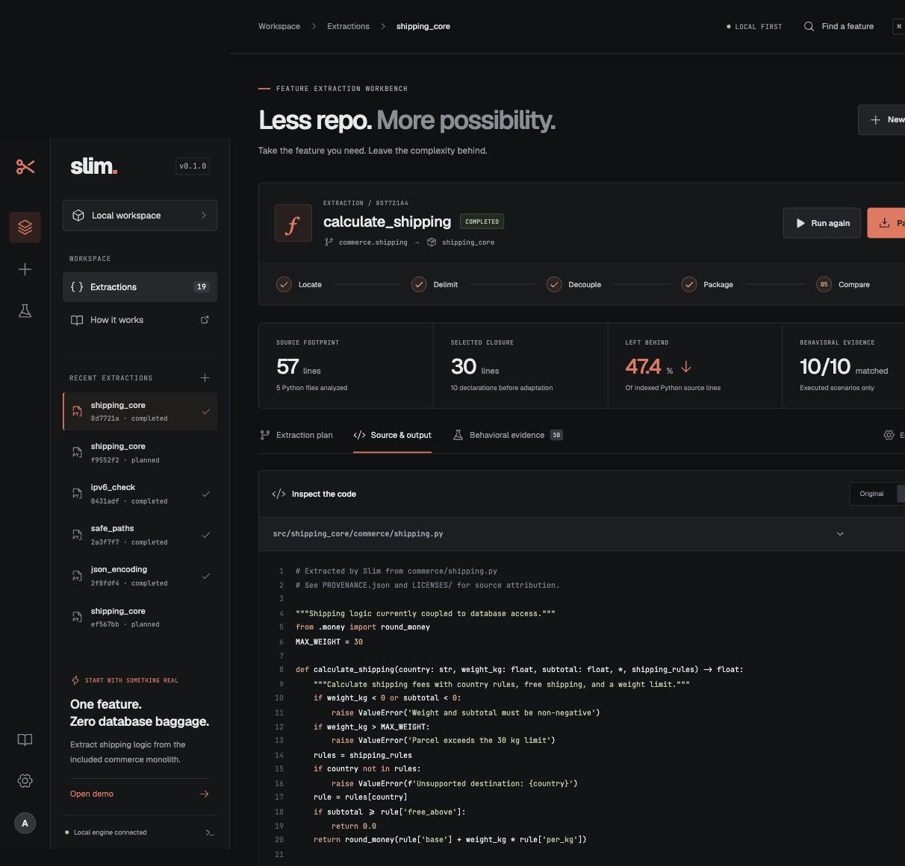
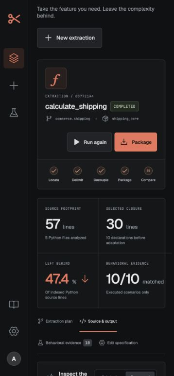

# Verification evidence — 4 November 2026

These are outputs of actual local runs, not simulated benchmark results.

| Repository | Exact source commit | Indexed Python files | Indexed lines | Selected source lines | Scenarios matched |
| --- | --- | ---: | ---: | ---: | ---: |
| Requests | `3c7baaa05ab4aa49cc819ce3a819d260de19c157` | 37 | 12,032 | 51 | 12 / 12 |
| Werkzeug | `2adaad1ab68312fa46efb07ff072b15b720e2444` | 142 | 37,571 | 90 | 10 / 10 |
| Django | `1860f0a3f41e54f265e57de76d320ea0887d6b1c` | 2,942 | 531,338 | 19 | 12 / 12 |

“Indexed lines” includes the repository's parseable Python files, including tests;
it is not a claim about production code size. “Selected source lines” counts the
original declaration ranges, not the final generated package size. Matching is
limited to the executed scenarios and return/exception comparison contract.

* [Raw upstream evidence](benchmark-2026-11-04.json): each scenario and original/candidate outcome.
* [Llama-assisted commerce extraction](llama-extraction-2026-11-04.json): actual
  `llama3.2:3b` plan, explicit DB boundary, generated manifest and 10 matching scenarios.
* Three upstream wheels were installed together with `--no-deps` in a fresh virtual
  environment. The independent consumer verified encoding detection, safe paths,
  traversal rejection and IPv6 validation without installing the source frameworks.
* The commerce wheel was installed separately in another fresh environment. Its
  delivery fee was 7.3 and its free-shipping result was 0.0, with explicit rules.
* All four wheels were inspected for bundled upstream licenses and provenance.
* 27 Python tests passed locally on Python 3.12.16; Ruff and production TypeScript/Vite
  builds passed. The worker runs in child processes, so the reported in-process
  coverage does not measure its execution.
* The desktop browser path was exercised: actual Llama advice → reviewed plan →
  extraction → removed DB declarations → original/output inspection → 10 matching
  cases → expanded exception detail. Mobile testing found and corrected a stage
  overflow; the final narrow viewport had no document-level horizontal overflow.
* Docker execution was attempted but new containers remained in `Created` state
  on this Docker Desktop, including a minimal smoke test. Docker validation is
  **unverified** in this environment. Owned test containers were removed. The local
  runner is the verified path for the recording.

## Captures

Reproduce with the commands in [the demo guide](../docs/demo.md). Source checkouts,
build products and consumer environments are ignored; this directory intentionally
contains only shareable evidence and screenshots.
